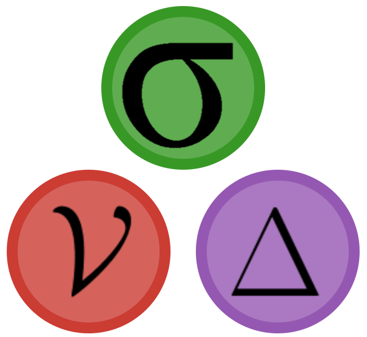

```@raw html
<div class="fc-hero">
<div class="fc-hero-text">
<p class="fc-eyebrow"> FinancialFFT.jl</p>
```

# Fourier Pricing for Lévy and Stochastic-Volatility Models

```@raw html
<p class="fc-lede">Price European options, binaries and whole smiles from the characteristic function of the model: Lewis, COS and Carr–Madan in Julia, differentiable by every AD backend and on the GPU.</p>
<nav class="fc-cta">
<a class="fc-btn fc-btn-primary" href="#Quick-start">Get Started <span aria-hidden="true">→</span></a>
<a class="fc-btn" href="https://github.com/rcalxrc08/FinancialFFT.jl"><svg viewBox="0 0 16 16" aria-hidden="true"><path d="M8 0C3.58 0 0 3.58 0 8c0 3.54 2.29 6.53 5.47 7.59.4.07.55-.17.55-.38 0-.19-.01-.82-.01-1.49-2.01.37-2.53-.49-2.69-.94-.09-.23-.48-.94-.82-1.13-.28-.15-.68-.52-.01-.53.63-.01 1.08.58 1.23.82.72 1.21 1.87.87 2.33.66.07-.52.28-.87.51-1.07-1.78-.2-3.64-.89-3.64-3.95 0-.87.31-1.59.82-2.15-.08-.2-.36-1.02.08-2.12 0 0 .67-.21 2.2.82.64-.18 1.32-.27 2-.27.68 0 1.36.09 2 .27 1.53-1.04 2.2-.82 2.2-.82.44 1.1.16 1.92.08 2.12.51.56.82 1.27.82 2.15 0 3.07-1.87 3.75-3.65 3.95.29.25.54.73.54 1.48 0 1.07-.01 1.93-.01 2.2 0 .21.15.46.55.38A8.013 8.013 0 0016 8c0-4.42-3.58-8-8-8z"/></svg> View on GitHub</a>
</nav>
<pre class="fc-hero-code"><code><span class="k">model</span> = HestonProcess(0.4, 0.2, 0.0, 1.5, -0.7, 0.04, Underlying(S0, d))
<span class="k">price</span> = pricer(model, ZeroRate(r), CosMethod(2^10), EuropeanOption(T, K))
<span class="k">smile</span> = pricer(model, ZeroRate(r), CosMethod(2^10), smile_of_strikes)  <span class="c"># one call</span></code></pre>
</div>
<figure class="fc-hero-figure">


<figcaption><span class="fc-legend"><i class="fc-ramp"></i>implied volatility of Heston, one COS smile per maturity</span>
Computed with FinancialFFT.jl when this site was built: 34 smiles of 46 strikes, inverted with FinancialToolbox's blsimpv.</figcaption>
</figure>
</div>
```


```@raw html
<div class="fc-stats"><div class="fc-stat "><div class="fc-stat-value">279<span> μs</span></div><div class="fc-stat-label">one Heston price, CosMethod(2^10), on a laptop CPU</div></div><div class="fc-stat is-teal"><div class="fc-stat-value">714<span> μs</span></div><div class="fc-stat-label">a whole smile of 101 strikes: the strikes share the characteristic function</div></div><div class="fc-stat is-amber"><div class="fc-stat-value">1.4<span>×</span></div><div class="fc-stat-label">the cost of a ForwardDiff gradient of a COS price, relative to the price</div></div><div class="fc-stat "><div class="fc-stat-value">8<span></span></div><div class="fc-stat-label">AD backends supported, from DualNumbers to Enzyme</div></div></div>
<p class="fc-machine">Measured with <code>benchmark/ad.jl</code> on an Intel Core i7-8550U, see <a href="ad/#Choosing-a-back-end">Automatic differentiation</a>.</p>
```

## What it does

```@raw html
<p class="fc-section-lede">A model enters only through its characteristic exponent, so pricing Merton, Kou, Variance Gamma, NIG or Heston costs about as much as Black and Scholes: <em>a quadrature, a cosine series or an FFT, with no simulation noise</em>.</p>
<div class="fc-grid fc-features">
<article class="fc-card"><div class="fc-icon"><svg viewBox="0 0 32 32"><path d="M3 16c3-9 6-9 9 0s6 9 9 0 6-9 8-4"/><circle cx="12" cy="16" r="2" /></svg></div>
<h3>Fourier pricing methods</h3><p><code>LewisMethod</code>, <code>CosMethod</code>, <code>CarrMadanLewisMethod</code>, <code>CarrMadanMethod</code>, each a configurator passed to <code>pricer</code>.</p><p class="fc-why">COS converges exponentially: the rounding floor with a few dozen terms on Black–Scholes.</p></article>
<article class="fc-card"><div class="fc-icon"><svg viewBox="0 0 32 32"><path d="M3 26 C10 26 11 6 16 6 S22 26 29 26"/><path d="M16 6v20"/></svg></div>
<h3>Densities of the log-return</h3><p><code>density</code> by COS expansion or FFT inversion, evaluated anywhere, on the CPU or the GPU.</p><p class="fc-why">The input of likelihood-ratio and Vibrato estimators of the Greeks.</p></article>
<article class="fc-card"><div class="fc-icon"><svg viewBox="0 0 32 32"><path d="M3 24 C9 24 10 8 16 8 S23 20 29 12"/><circle cx="16" cy="8" r="2.4"/></svg></div>
<h3>Six models</h3><p>Black–Scholes, Merton, Kou, Variance Gamma, NIG and Heston, from FinancialMonteCarlo.jl.</p><p class="fc-why">One code path for Lévy and stochastic volatility models.</p></article>
<article class="fc-card"><div class="fc-icon"><svg viewBox="0 0 32 32"><rect x="4" y="4" width="7" height="7" rx="1.5"/><rect x="12.5" y="4" width="7" height="7" rx="1.5"/><rect x="21" y="4" width="7" height="7" rx="1.5"/><rect x="4" y="12.5" width="7" height="7" rx="1.5"/><rect x="12.5" y="12.5" width="7" height="7" rx="1.5" class="hl"/><rect x="21" y="12.5" width="7" height="7" rx="1.5"/><path d="M16 21v7"/></svg></div>
<h3>Options and smiles</h3><p>European and binary calls and puts, alone or as a smile of many strikes at one maturity.</p><p class="fc-why">A smile reuses the characteristic function: 101 strikes cost 2.6 single prices.</p></article>
<article class="fc-card"><div class="fc-icon"><svg viewBox="0 0 32 32"><path d="M4 9h24M4 16h24M4 23h24"/><circle cx="10" cy="9" r="2.4"/><circle cx="20" cy="16" r="2.4"/><circle cx="14" cy="23" r="2.4"/></svg></div>
<h3>Curves</h3><p>Non-constant zero rates and dividends, as in FinancialMonteCarlo.jl.</p><p class="fc-why">Market term structures without a change of method.</p></article>
<article class="fc-card"><div class="fc-icon"><svg viewBox="0 0 32 32"><path d="M4 26 16 6l12 20z"/><path d="M10 26 16 16l6 10"/></svg></div>
<h3>Every AD backend</h3><p>DualNumbers, HyperDualNumbers, ForwardDiff, ReverseDiff, Zygote, Mooncake, Enzyme, TaylorSeries.</p><p class="fc-why">Greeks of any order with the backend your code already uses.</p></article>
<article class="fc-card"><div class="fc-icon"><svg viewBox="0 0 32 32"><rect x="7" y="7" width="18" height="18" rx="3"/><rect x="12" y="12" width="8" height="8" rx="1"/><path d="M11 3v4M16 3v4M21 3v4M11 25v4M16 25v4M21 25v4M3 11h4M3 16h4M3 21h4M25 11h4M25 16h4M25 21h4"/></svg></div>
<h3>GPU</h3><p>Every method on CUDA, with the accuracy it has on the CPU; ForwardDiff and Zygote differentiate there.</p><p class="fc-why">Smiles stay on the device, from characteristic function to price.</p></article>
<article class="fc-card"><div class="fc-icon"><svg viewBox="0 0 32 32"><ellipse cx="16" cy="16" rx="12" ry="6"/><ellipse cx="16" cy="16" rx="7" ry="3.2"/><circle cx="16" cy="16" r="1.6" class="hl"/></svg></div>
<h3>Calibration</h3><p>Model volatilities by <code>blsimpv</code>, their Jacobian by AD, Levenberg–Marquardt and implicit sensitivities.</p><p class="fc-why">A worked Heston calibration, step by step, that FinancialCalibrator.jl reproduces.</p></article>
</div>
```

## How it fits together

```@raw html
<p class="fc-section-lede">A model, a method and a payoff go into one <code>pricer</code> call; the price is generic in the number type, so derivatives come back through the same call.</p>
<div class="fc-arch">
<ol class="fc-flow" style="--fc-steps: 6">
<li><span class="fc-node-k">01</span><b>Model</b><span>characteristic exponent of the log-price<br><code>HestonProcess</code>, <code>KouProcess</code>, …</span></li>
<li><span class="fc-node-k">02</span><b>Curves</b><span>zero rate and dividends<br><code>ZeroRate</code>, <code>Underlying</code></span></li>
<li class="fc-core"><span class="fc-node-k">03</span><b>Method</b><span>quadrature, cosine series or FFT<br><code>CosMethod</code>, <code>LewisMethod</code></span></li>
<li><span class="fc-node-k">04</span><b>Payoff</b><span>an option or a smile<br><code>EuropeanOption</code>, smiles</span></li>
<li><span class="fc-node-k">05</span><b>Price or density</b><span><code>pricer</code>, <code>density</code></span></li>
<li class="fc-out"><span class="fc-node-k">06</span><b>Greeks</b><span>any AD backend, on CPU or GPU</span></li>
</ol>
<div class="fc-backflow"><span>∂price/∂θ</span> = AD through <span>pricer</span> <em>← dual numbers or cotangents through the payoff, the method and the characteristic exponent</em></div>
</div>
```

## Results

```@raw html
<p class="fc-section-lede">Computed with the package when this site is built.</p>
<div class="fc-tabs">
<input type="radio" name="fc-results" id="fc-results-1" checked><label for="fc-results-1">Smiles</label>
<input type="radio" name="fc-results" id="fc-results-2"><label for="fc-results-2">Convergence</label>
<input type="radio" name="fc-results" id="fc-results-3"><label for="fc-results-3">Densities</label>
<input type="radio" name="fc-results" id="fc-results-4"><label for="fc-results-4">Calibration</label>
<div class="fc-tab-panels">
<figure class="fc-tab-panel"><figcaption><b>Six models, one smile each.</b> Implied volatilities at T = 1 from one CosMethod smile per model, inverted with blsimpv.</figcaption></figure>
<figure class="fc-tab-panel"><figcaption><b>Convergence.</b> Error against the closed form of Black and Scholes, as a function of the evaluations of the characteristic exponent.</figcaption></figure>
<figure class="fc-tab-panel"><figcaption><b>Densities.</b> The densities of the log-return by COS expansion and FFT inversion.</figcaption></figure>
<figure class="fc-tab-panel"><figcaption><b>Calibration.</b> Heston fitted by Levenberg–Marquardt, see <a href="calibration/">Calibration</a>.</figcaption></figure>
</div>
</div>
```

## GPU

The execution mode is part of the method, as in FinancialMonteCarlo.jl: with CUDA.jl loaded, a method built with
`mode = FinancialMonteCarlo.CudaMode()` evaluates the characteristic function and the integrals on the GPU, and
`FinancialMonteCarlo.with_mode(method, mode)` gives a copy of a method in another mode:

```julia
using CUDA
smile = FinancialMonteCarlo.EuropeanOptionSmile(T, [90.0, 100.0, 110.0], [true, true, false])
pricer(model, zero_rate, CosMethod(2^12; mode = FinancialMonteCarlo.CudaMode()), smile)
```

- Every method runs on the GPU, with the accuracy it has on the CPU.
- `density(model, zero_rate, FFTDensityInverter(; mode = FinancialMonteCarlo.CudaMode()), T)` computes the density on the GPU with `FFTDensityInverter` and `CosDensityMethod`, and [`FinancialFFT.density_values`](@ref) evaluates it there at a `CuArray` of points, differentiable with ForwardDiff.jl and Zygote.jl.
- The strikes of a smile are moved to the device of the mode, wherever they are; the prices of a smile stay on the GPU.
- ForwardDiff.jl and Zygote.jl differentiate the prices on the GPU. ReverseDiff.jl is not supported on the GPU, and Mooncake.jl differentiates only the binary Lewis option there, see [Known limitations](ad.md#Known-limitations).

## Quick start

```@raw html
<p class="fc-section-lede">Five steps, every output computed when this site was built.</p>
```

```@raw html
<div class="fc-step"><span class="fc-step-n">1</span><div><h3>Install the package</h3><p>FinancialFFT.jl and FinancialMonteCarlo.jl are in a registry of their own, added once.</p></div></div>
```

```julia
] registry add https://github.com/rcalxrc08/LocalRegistry.git
] add FinancialFFT, FinancialMonteCarlo
```

```@raw html
<div class="fc-step"><span class="fc-step-n">2</span><div><h3>Describe the model and the option</h3><p>The model, the curve and the payoff are FinancialMonteCarlo.jl types.</p></div></div>
```

```@example quickstart
using FinancialFFT, FinancialMonteCarlo

S0, K, r, d, T, σ = 100.0, 100.0, 0.02, 0.01, 1.0, 0.2
model = BlackScholesProcess(σ, Underlying(S0, d))
zero_rate = ZeroRate(r)
option = EuropeanOption(T, K)
nothing # hide
```

```@raw html
<div class="fc-step"><span class="fc-step-n">3</span><div><h3>Price it</h3><p>The method is the last-but-one argument.</p></div></div>
```

```@example quickstart
pricer(model, zero_rate, LewisMethod(600.0, 20000), option)
```

```@raw html
<div class="fc-step"><span class="fc-step-n">4</span><div><h3>Change model and method</h3><p>One argument each.</p></div></div>
```

```@example quickstart
merton = MertonProcess(σ, 5.0, 0.03, 0.02, Underlying(S0, d))
pricer(merton, zero_rate, CosMethod(2^12), option)
```

```@raw html
<div class="fc-step"><span class="fc-step-n">5</span><div><h3>Price a smile</h3><p>Many strikes at one maturity share the characteristic function.</p></div></div>
```

```@example quickstart
strikes = [80.0, 90.0, 100.0, 110.0, 120.0]
smile = FinancialMonteCarlo.EuropeanOptionSmile(T, strikes, strikes .>= S0)
pricer(merton, zero_rate, CosMethod(2^12), smile)
```

```@raw html
<div class="fc-next">
<a href="methods/"><b>Methods</b><span>Lewis, COS, Carr–Madan and the densities, compared.</span></a>
<a href="ad/"><b>Automatic differentiation</b><span>Eight backends, timed, and their limits.</span></a>
<a href="calibration/"><b>Calibration</b><span>Heston to a smile, with implicit sensitivities.</span></a>
<a href="api/"><b>API reference</b><span>Every exported function and type.</span></a>
</div>
```

## The ecosystem

The package adds methods to the `pricer` of [FinancialMonteCarlo.jl](https://github.com/rcalxrc08/FinancialMonteCarlo.jl)
and uses its types for everything else, so moving a European option from simulation to a Fourier method changes one
argument. [FinancialCalibrator.jl](https://github.com/rcalxrc08/FinancialCalibrator.jl) calibrates with these methods,
and [VibratoMonteCarlo.jl](https://github.com/rcalxrc08/VibratoMonteCarlo.jl) uses the densities. The GPU tests run with
`Pkg.test("FinancialFFT"; test_args = ["gpu"])` on a machine with a CUDA GPU. More projects at
[rcalxrc08.github.io](https://rcalxrc08.github.io/).
